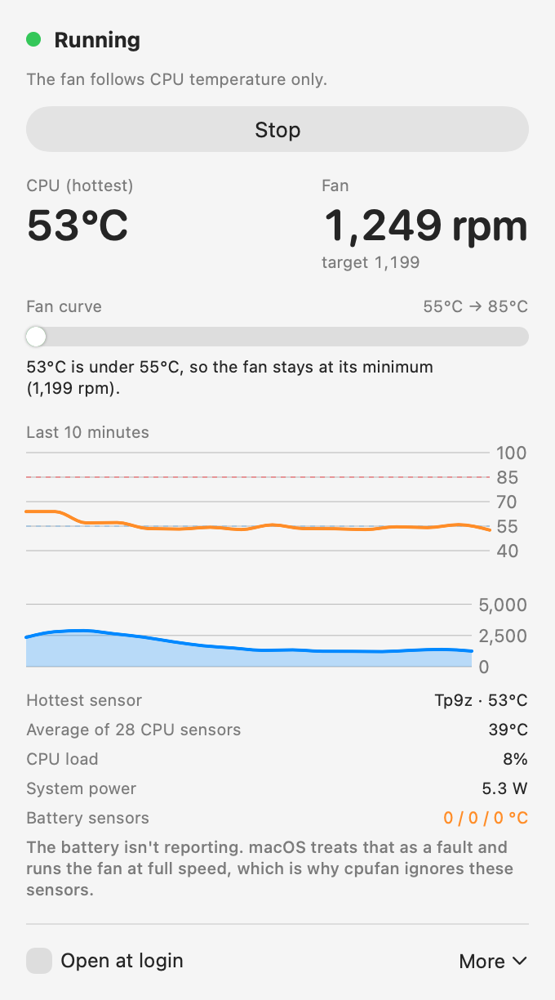

# CPU Fan

A tiny menu bar app that makes a Mac's fan follow **CPU temperature only**.

I wrote it for a MacBook whose battery had failed. The battery's temperature sensors read 0 °C,
macOS treats that as a fault, and the fan runs at full speed (7,200 rpm) all the time even
when the CPU is cool. CPU Fan takes over the fan, ignores the battery sensors, and sets the
speed from the hottest CPU sensor instead.

<picture>
  <source media="(prefers-color-scheme: dark)" srcset="docs/panel-dark.png">
  
</picture>

## How it works

* **`cpufan`** (`cpufan.c`) is a small background service that talks to the Mac's System
  Management Controller (SMC) through IOKit. Every 2 seconds it reads the CPU temperature
  sensors, takes the hottest one, and sets the fan target:
  * at or below **55 °C**: minimum speed
  * at or above **85 °C**: full speed
  * in between: a straight line from minimum to full speed

  It reacts to rising heat right away and eases down gently as the CPU cools. If it can't
  read the CPU, or it's stopped for any reason, it hands the fan back to macOS.
* **CPU Fan.app** (`CPUFanApp.swift`) is a SwiftUI menu bar app. It shows live readings and
  why the fan is at its current speed, along with 10-minute history charts. It also has
  Start/Stop buttons.

Installing the service asks for your admin password once, with the normal macOS prompt.
After that, Start and Stop don't ask for it. Stop creates a `paused` file that the service
checks, and Start removes it.

## Build and install

Needs the Xcode Command Line Tools (`xcode-select --install`). No Xcode project or
third-party code.

```bash
bash build.sh         # builds "CPU Fan.app" and copies it to /Applications
open "/Applications/CPU Fan.app"
```

Then click the fan in the menu bar and choose **Install & Start…**.

To change the 55 °C / 85 °C points, edit `LOW`/`HIGH` at the top of `install.sh` and use
**More → Reinstall Service…** in the app.

## Command line

```bash
cpufan status      # CPU temperature and fan state
cpufan watch       # JSON readings every 2 s (what the app uses)
cpufan probe       # every fan/temperature/power key the SMC exposes
sudo cpufan auto   # hand the fan back to macOS right now
```

The service logs to `/var/log/cpufan.log`.

## Uninstall

In the app, choose **More → Uninstall Service…**, then delete `/Applications/CPU Fan.app`.
Or run `bash uninstall.sh`.

## Notes

* Tested on a 13-inch M1 MacBook Pro (2020) running macOS 27. On Apple Silicon it reads the
  `Tp…` CPU sensors, and on Intel it falls back to the `TC…` sensors. Intel support hasn't
  been tested.
* Apple Silicon slows the CPU down by itself when it gets too hot, so the CPU can't overheat
  even with the fan on a low setting.
* This works around the symptom. A battery that reports nothing still needs replacing, and
  a swollen battery should be replaced right away.
